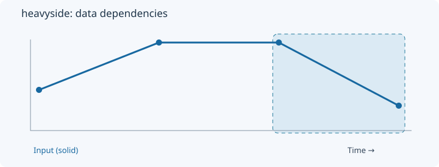
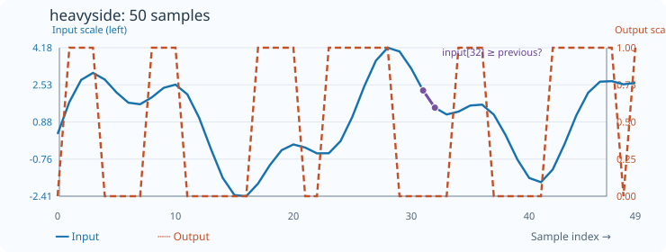

# Heavyside

[← Transform index](README.md) · [Rust source](../../src/transform/heavyside.rs)

## Algorithm

Emit one when the current value does not decrease, zero otherwise.

## Window diagram

The highlighted region indicates the samples consulted for the final illustrated output. Prefix and history transforms use a different dependency pattern.

## Input versus output

**50-sample effect plot:** nondecreasing consecutive comparison. The SVG contains 50 plotted values, with input/output data embedded in metadata. The Rust regression test `svg_effect_curves_match_actual_rust_transforms` decodes the orange curve and compares it with the implementation. The short numerical example below is separate.

**Numerical example:** input `[2,5,5,1]` → output `[0,1,1,0]`. One for nondecreasing adjacent values, including ties.

## Boundary conditions and interpretation

Equality counts as non-decreasing.

The blue line is the input and the dashed orange line is the transform output. Values are shown on a common vertical scale.
