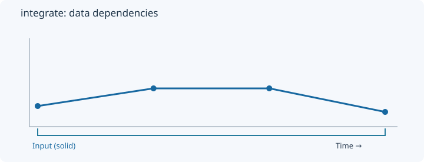
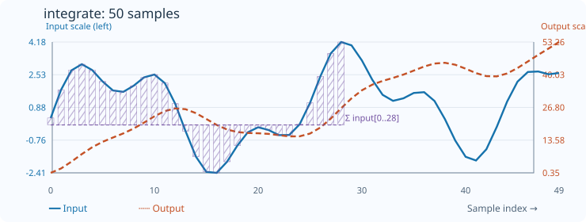

# Integrate

[← Transform index](README.md) · [Rust source](../../src/transform/integrate.rs)

## Algorithm

Compute the chronological cumulative sum.

## Window diagram

The highlighted region indicates the samples consulted for the final illustrated output. Prefix and history transforms use a different dependency pattern.

## Input versus output

**50-sample effect plot:** cumulative sum. The SVG contains 50 plotted values, with input/output data embedded in metadata. The Rust regression test `svg_effect_curves_match_actual_rust_transforms` decodes the orange curve and compares it with the implementation. The short numerical example below is separate.

**Numerical example:** input `[2,5,5,1]` → output `[2,7,12,13]`. Cumulative sum of input values.

## Boundary conditions and interpretation

Every output depends only on the current and earlier samples.

The blue line is the input and the dashed orange line is the transform output. Values are shown on a common vertical scale.
