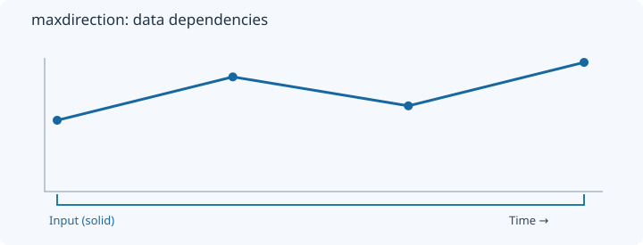
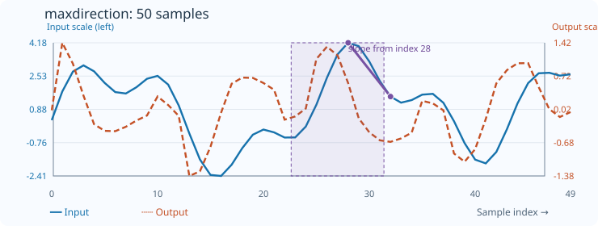

# MaxDirection

[← Transform index](README.md) · [Rust source](../../src/transform/maxdirection.rs)

## Algorithm

Measure slope from the more recent trailing extremum to the current value.

## Window diagram

The highlighted region indicates the samples consulted for the final illustrated output. Prefix and history transforms use a different dependency pattern.

## Input versus output

**50-sample effect plot:** count=9 preceding samples. The SVG contains 50 plotted values, with input/output data embedded in metadata. The Rust regression test `svg_effect_curves_match_actual_rust_transforms` decodes the orange curve and compares it with the implementation. The short numerical example below is separate.

**Numerical example:** input `[2,5,3,6]` → output `[0,3,-2,3]`. Slope from the younger historical extremum to the current sample.

## Interpretation and caveats

Illustration is simplified; inspect the source for exact tie behavior.

The blue solid line is input; the orange dashed line is output. Unless explicitly stated as a verified fixture, these are illustrative values.
