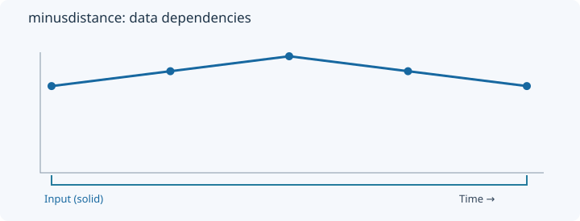
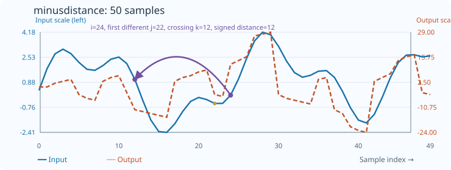

# MinusDistance

[← Transform index](README.md) · [Rust source](../../src/transform/minusdistance.rs)

## Algorithm

Search backwards for a historical level crossing and report signed temporal distance.

## Window diagram

The highlighted region indicates the samples consulted for the final illustrated output. Prefix and history transforms use a different dependency pattern.

## Input versus output

**50-sample effect plot:** historical crossing distance. The SVG contains 50 plotted values, with input/output data embedded in metadata. The Rust regression test `svg_effect_curves_match_actual_rust_transforms` decodes the orange curve and compares it with the implementation. The short numerical example below is separate.

**Numerical example:** input `[1,2,3,2,1]` → output `[0,0,2,3,-4]`. Signed number of steps back to a historical level crossing.

## Interpretation and caveats

The immediate predecessor is skipped; no future samples are consulted.

The blue solid line is input; the orange dashed line is output. Unless explicitly stated as a verified fixture, these are illustrative values.
