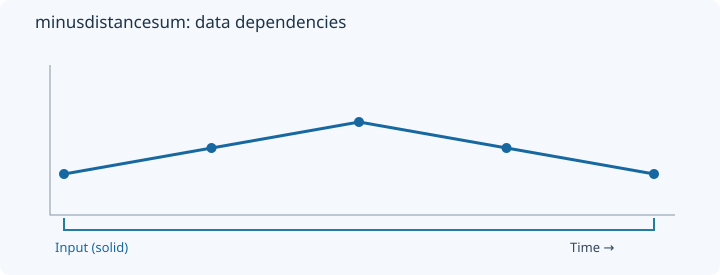
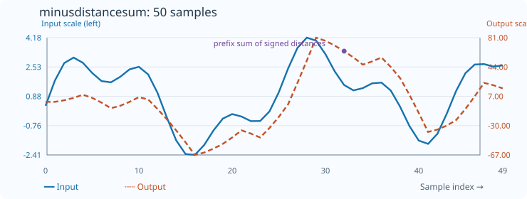

# MinusDistanceSum

[← Transform index](README.md) · [Rust source](../../src/transform/minusdistancesum.rs)

## Algorithm

Compute the chronological cumulative sum of MinusDistance outputs.

## Window diagram

The highlighted region indicates the samples consulted for the final illustrated output. Prefix and history transforms use a different dependency pattern.

## Input versus output

**50-sample effect plot:** cumulative crossing distances. The SVG contains 50 plotted values, with input/output data embedded in metadata. The Rust regression test `svg_effect_curves_match_actual_rust_transforms` decodes the orange curve and compares it with the implementation. The short numerical example below is separate.

**Numerical example:** input `[1,2,3,2,1]` → output `[0,0,2,5,1]`. Cumulative sum of historical crossing distances.

## Interpretation and caveats

Accumulates distances, not original sample values.

The blue solid line is input; the orange dashed line is output. Unless explicitly stated as a verified fixture, these are illustrative values.
