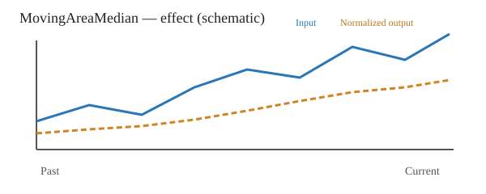
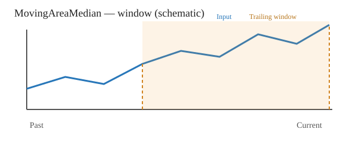

# MovingAreaMedian

[← Transform index](README.md) · [Rust source](../../src/transform/movingareamedian.rs)

## Algorithm

For each complete trailing window of `count >= 2` equally spaced samples, subtract the window minimum and integrate the resulting nonnegative, piecewise-linear curve using trapezoids. Find the earliest time where the cumulative area reaches half the total, interpolating within the crossing trapezoid. Return that time divided by `count - 1`, hence a value in [0, 1].

This is a **time coordinate**, not a median sample value or the arithmetic mean. A rising linear sequence yields approximately 0.70710678; a falling linear sequence yields approximately 0.29289322. The result is invariant to positive affine changes in input values, subject to floating-point precision.

The implementation scales the shifted heights and uses compensated summation. For constant windows the result is 0.5. If half the area is reached along a zero-height plateau, its midpoint is selected.

## Input versus output

Schematic illustration only, **not** a numeric regression plot. Blue shows input; orange shows the normalized median-area time position for trailing windows. Initial outputs use `default_out`.

## Window diagram

The median-area time is found using only the current and preceding `count - 1` samples.

## Contracts and limitations

- `MovingAreaMedian::<f64>::new(count)` implements `SequenceTransform`.
- Requires `2 <= count <= input.len()` and output length equal to input length; otherwise `TransformResult::Error(0)`.
- Nonfinite converted inputs yield `Error(1)`; unrepresentable outputs or numerical failure yield `Error(2)`.
- The first `count - 1` outputs retain `default_out`.
- Uniform sample spacing is assumed. Large offsets relative to tiny variations may lose precision during floating-point conversion.
- Tests: [tests/transform/movingareamedian_test.rs](../../tests/transform/movingareamedian_test.rs). No tests are embedded in `src`.
