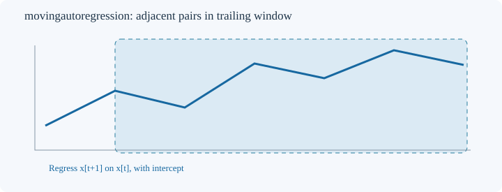
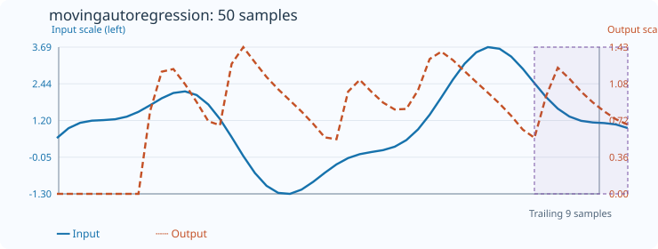

# MovingAutoregression

[← Transform index](README.md) · [Rust source](../../src/transform/movingautoregression.rs)

## Algorithm

Estimate the coefficient φ in the trailing AR(1) regression `x[t+1] = a + φ x[t] + ε[t]`, with an independently estimated intercept. Each window of `count` input samples supplies `count-1` adjacent pairs. The OLS slope is centered covariance divided by centered predictor variance. `new(count)` requires `count >= 3`.

## Window diagram

The shaded trailing window supplies adjacent pairs; neither the following sample nor any later input is used. The line is schematic, not a fitted AR regression.

## Input versus output

**50-sample effect plot:** count=9, default_out=0. The SVG embeds 50 inputs and 50 outputs. The Rust test `svg_effect_curves_match_actual_rust_transforms` checks its values and coordinates.

**Numerical example:** input `[1,3,7,15]` with count=4 and default_out=0 → output `[0,0,0,2]`; the pairs follow `y=2x+1`.

## Boundary conditions and interpretation

The first `count-1` outputs retain `default_out`. Constant predictor windows have undefined slope and retain `default_out`. Nonfinite inputs and invalid lengths/windows return errors. Centering avoids catastrophic cancellation from large offsets. φ describes local persistence, not predictive performance on future observations.

Blue solid: input (left axis); orange dashed: coefficient (right axis).