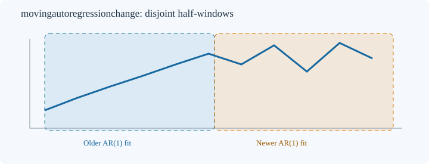
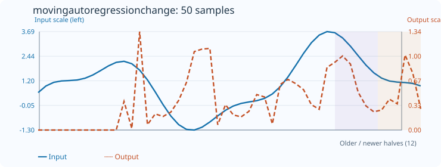

# MovingAutoregressionChange

[← Transform index](README.md) · [Rust source](../../src/transform/movingautoregressionchange.rs)

## Algorithm

Measure the absolute difference between the AR(1) ordinary-least-squares coefficients estimated separately on two **disjoint** halves of a trailing window. Both regressions include an intercept:

`x[t+1] = a + φ x[t] + ε[t]`

Output `abs(φ_new - φ_old)`. The constructor `new(count)` requires an **even** sample count of at least 6. Each half contains `count/2` observations and `count/2 - 1` adjacent regression pairs. The pair crossing the half-window boundary is deliberately excluded.

## Window diagram

The older and newer shaded regions are distinct. Both estimates use only samples in their respective halves. The drawn sequence is schematic, not a regression fit.

## Input versus output

**50-sample effect plot:** count=12, default_out=0. The SVG embeds 50 input and output values. The Rust test `svg_effect_curves_match_actual_rust_transforms` compares its values and coordinates to the implementation.

**Numerical example:** input `[1,3,7,15,31,63,2,8,2,8,2,8]`, count=12, default_out=0 produces eleven initial zeros and a final value of `3`. The older half follows `y=2x+1`, while the newer half alternates between 2 and 8 with `φ=-1`.

## Boundary conditions and interpretation

The first `count-1` outputs retain `default_out`. If either half has zero predictor variance or an undefined/nonfinite coefficient, the corresponding output retains `default_out`. Invalid parameters and nonfinite input samples return errors. Each regression centers both predictor and response to reduce cancellation from large offsets.

A large difference can indicate changing local dynamics, but also arises from estimation noise. This is **not** a statistical change-point test or a measure of out-of-sample predictive accuracy.

Blue solid: input (left axis); orange dashed: absolute coefficient change (right axis).
