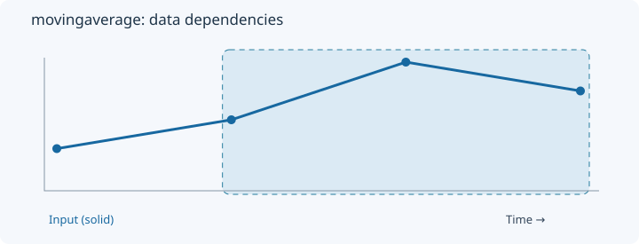
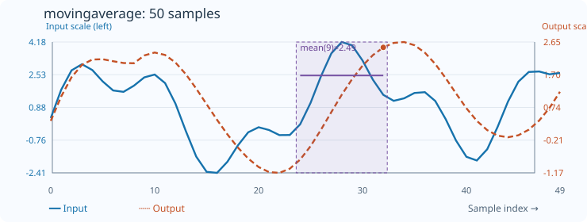

# MovingAverage

[← Transform index](README.md) · [Rust source](../../src/transform/movingaverage.rs)

## Algorithm

Compute the trailing arithmetic mean over up to count samples.

## Window diagram

The highlighted region indicates the samples consulted for the final illustrated output. Prefix and history transforms use a different dependency pattern.

## Input versus output

**50-sample effect plot:** count=9. The SVG contains 50 plotted values, with input/output data embedded in metadata. The Rust regression test `svg_effect_curves_match_actual_rust_transforms` decodes the orange curve and compares it with the implementation. The short numerical example below is separate.

**Numerical example:** input `[2,4,8,6]` → output `[2,3,4.666666666666667,6]`. Trailing arithmetic mean, count=3.

## Boundary conditions and interpretation

The first outputs use shorter available prefixes; example count=3.

The blue line is the input and the dashed orange line is the transform output. Values are shown on a common vertical scale.
