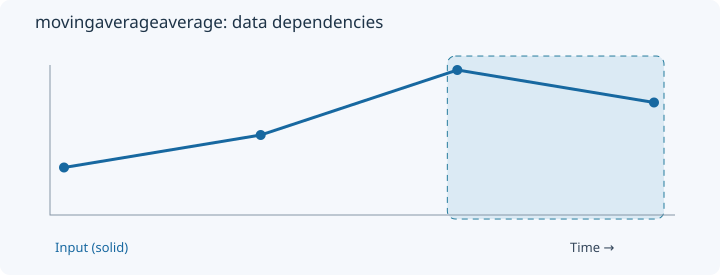
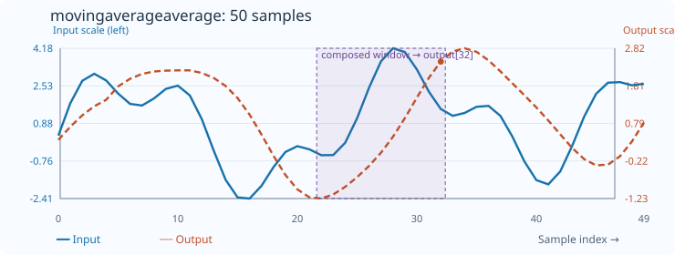

# MovingAverageAverage

[← Transform index](README.md) · [Rust source](../../src/transform/movingaverageaverage.rs)

## Algorithm

Apply two trailing arithmetic means in sequence.

## Window diagram

The highlighted region indicates the samples consulted for the final illustrated output. Prefix and history transforms use a different dependency pattern.

## Input versus output

**50-sample effect plot:** first_count=7, second_count=5. The SVG contains 50 plotted values, with input/output data embedded in metadata. The Rust regression test `svg_effect_curves_match_actual_rust_transforms` decodes the orange curve and compares it with the implementation. The short numerical example below is separate.

**Numerical example:** input `[2,4,8,6]` → output `[2,2.5,4.5,6.5]`. Two trailing arithmetic means, counts 2 and 2.

## Boundary conditions and interpretation

Illustrative example uses first_count=2 and second_count=2.

The blue line is the input and the dashed orange line is the transform output. Values are shown on a common vertical scale.
