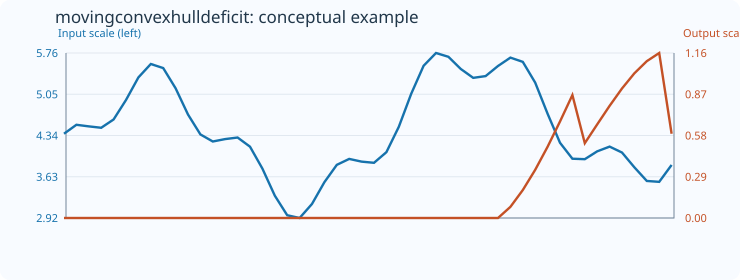
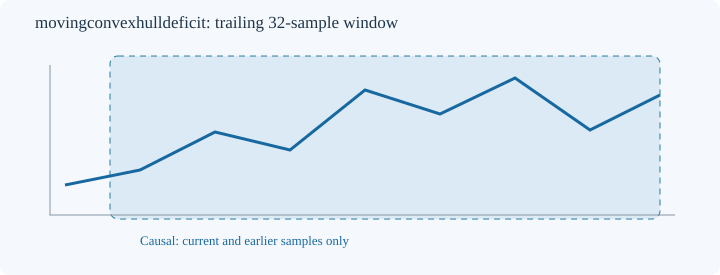

# MovingConvexHullDeficit

[← Transform index](README.md) · [Rust source](../../src/transform/movingconvexhulldeficit.rs)

## Algorithm

Represent the trailing graph as points ((i/(count-1)), (x[i]-min)/(max-min)) in the unit square. Compute the convex hull via the monotone-chain algorithm and its polygon area A, then output 1-A. This is a *hull-area deficit*, not a measure of concavity or fractal dimension. For a perfectly straight nonconstant line the hull has zero area and the deficit equals 1. Constant windows are undefined and retain default_out. The result is invariant to positive affine changes of the sample values and bounded to [0,1].

All computations use only the current trailing window. The default example uses `MovingConvexHullDeficit::<f64>::new(32)`.

## Input versus output

The 50-sample conceptual illustration uses count 32; initial positions receive `default_out=0`. Blue represents the input and orange the output, each on its own vertical scale. The SVG is a schematic visualization, not a numerical regression reference.

## Window diagram

Only prior and current samples enter the calculation.

## Contracts and limitations

- Invalid window configuration or mismatched output size yields `TransformResult::Error(0)`; nonfinite input yields `Error(1)`; failed conversion yields `Error(2)`.
- Unavailable prefixes and undefined measurements preserve `default_out`.
- Finite-window descriptors are sensitive to sample rate and window length. They do not establish predictive power.

