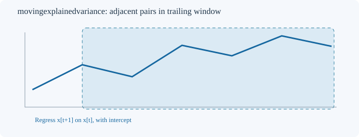
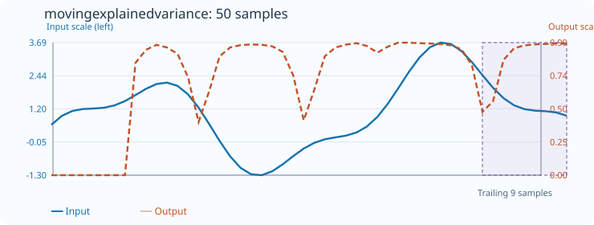

# MovingExplainedVariance

[← Transform index](README.md) · [Rust source](../../src/transform/movingexplainedvariance.rs)

## Algorithm

Estimate the local coefficient of determination R² of an AR(1) regression with intercept. For the `count-1` adjacent pairs `(x[t], x[t+1])` in each trailing window of `count` samples, calculate the squared Pearson correlation:

`R² = covariance(x,y)² / (variance(x) × variance(y))`.

`new(count)` requires `count >= 3`. The result is in `[0,1]` for defined windows. Unlike `MovingAutoregression`, it measures in-window linear fit rather than the slope.

## Window diagram

The shaded window supplies adjacent pairs, and no future observations are consulted. The line is schematic, not a fitted AR regression.

## Input versus output

**50-sample effect plot:** count=9, default_out=0. The SVG embeds 50 inputs and 50 outputs. The Rust test `svg_effect_curves_match_actual_rust_transforms` checks its values and coordinates.

**Numerical example:** input `[1,3,7,15]`, count=4, default_out=0 → output `[0,0,0,1]` because every adjacent pair follows `y=2x+1`.

## Boundary conditions and interpretation

The first `count-1` outputs retain `default_out`. If either predictor or response variance is zero, R² is undefined and the output retains `default_out`. Invalid windows, lengths and nonfinite inputs return errors. Both axes are centered to handle large common offsets. R² is nonnegative even when the fitted slope is negative; it is not a measure of out-of-sample forecast quality. Strong persistence in level data can yield high R² without useful return predictability.

Blue solid: input (left axis); orange dashed: R² (right axis).