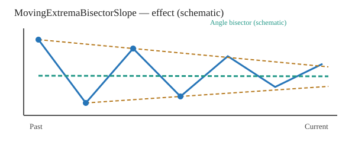
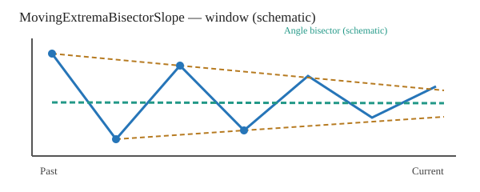

# MovingExtremaBisectorSlope

[← Transform index](README.md) · [Rust source](../../src/transform/movingextremabisectorslope.rs)

## Algorithm

In each complete trailing window, select the **two highest values** and the **two lowest values**, not local maxima or minima. Connect the upper pair and lower pair by straight lines. Ties are resolved deterministically by time index.

Normalize time to [0,1] and values by the window's height range. If the upper and lower slopes are `m_upper` and `m_lower`, the slope of the **right-facing internal angle bisector** is:

```text
m_bisector = tan((atan(m_upper) + atan(m_lower)) / 2)
```

This bisector passes through the intersection of the two lines whenever they intersect, but the intersection **need not be computed**. It bisects the angle between their right-pointing rays, not the arithmetic mean of the two slopes. Its sign indicates whether the bisector rises or falls toward the present; unlike `MovingExtremaConvergence`, it does **not** encode convergence versus divergence.

The result is a **dimensionless slope**, not an angle, and is **not restricted to [-1,1]**. Positive affine transformations of input values preserve the result within floating-point precision.

## Input versus output



Conceptual illustration only, not a numeric regression plot. Blue indicates the input and orange indicates a schematic bisector-slope output.

## Window diagram



Only the current and preceding `count - 1` samples determine the upper and lower lines.

## Contracts and limitations

- Usage: `MovingExtremaBisectorSlope::<f64>::new(count)`, with `count >= 4`.
- Output length must match input length, and `count <= input.len()`; invalid configuration yields `TransformResult::Error(0)`.
- Nonfinite input yields `Error(1)`; failed output conversion yields `Error(2)`.
- Incomplete windows and constant windows retain `default_out`.
- Numerical precision is limited by the input representation; the implementation scales values before taking differences to reduce overflow risk.
- Tests are in [tests/transform/movingextremabisectorslope_test.rs](../../tests/transform/movingextremabisectorslope_test.rs), following the `src → tests` mapping.
