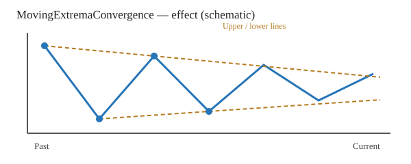
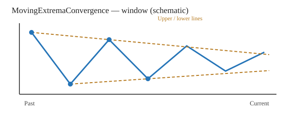

# MovingExtremaConvergence

[← Transform index](README.md) · [Rust source](../../src/transform/movingextremaconvergence.rs)

## Algorithm

Within each complete trailing window, select the two **highest sample values** and the two **lowest sample values** (not local extrema). Each pair defines a line. Equal values are ordered deterministically by their earlier index; the selected indices must be distinct.

Normalize time to [0,1] and sample heights by the window range. Compute slopes `m_upper` and `m_lower`, then the unsigned angle between the two lines via `atan2(abs(m_lower-m_upper), 1+m_lower*m_upper)`.

Extrapolate both lines to the right edge of the window. If their signed vertical separation is shrinking, output a **positive** angle; if widening, output a **negative** angle. The angle is divided by π, producing a result in [-1,1]. Parallel lines and an exact crossing at the right edge produce zero. This is an **edge-local convergence measure**, not an explicit finite intersection-time estimate; lines can also intersect inside the window.

The indicator is invariant under positive affine changes in sample values, subject to floating-point rounding. All calculations are causal.

## Input versus output

Schematic illustration only, not a numeric regression plot. Blue indicates the input and orange illustrates the signed convergence output.

## Window diagram

Two upper and two lower sample points in the current trailing window determine the two straight lines.

## Contracts and limitations

- `MovingExtremaConvergence::<f64>::new(count)` requires `count >= 4`.
- Output length must match input length; `count` cannot exceed input length. Invalid configuration yields `TransformResult::Error(0)`.
- Nonfinite inputs yield `Error(1)`; failed output conversion yields `Error(2)`.
- Incomplete windows and degenerate windows (including constant series) retain `default_out`.
- An extrapolated crossing in the future is not guaranteed by the sign alone if the lines have already crossed or lie in reversed order. The sign measures whether separation at the right edge is shrinking or growing.
- Tests are mapped to [tests/transform/movingextremaconvergence_test.rs](../../tests/transform/movingextremaconvergence_test.rs), not embedded in source.
