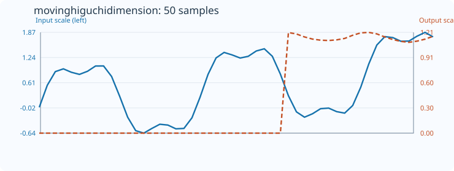
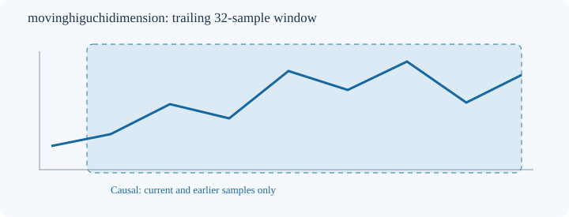

# MovingHiguchiDimension

[← Transform index](README.md) · [Rust source](../../src/transform/movinghiguchidimension.rs)

## Algorithm

**Higuchi graph dimension.** For each k=1..min(floor(N/4),16), form k offset subseries. For each offset m, sum absolute differences between samples k apart, multiply by (N-1)/(floor((N-1-m)/k)*k*k), and average the resulting lengths over valid offsets. Regress log(mean length) on log(1/k); its slope is the estimated dimension. At least two positive mean lengths are required. This is a finite-sample estimator, not a guaranteed value between 1 and 2; constant windows have no valid slope.

All estimates are computed on a trailing window ending at the output index, using only present and past samples. No future data or external libraries are used. The implementation lives in the shared [nonlinear-dynamics core](../../src/transform/movingfractal_core.rs).

## Input versus output

The plot contains **50 actual input samples and 50 computed output samples**, with `count=32` and `default_out=0`. The blue input curve and orange output curve use independent Y axes. Embedded SVG metadata and plotted coordinates are checked against the Rust implementation by `svg_effect_curves_match_actual_rust_transforms`.

## Window diagram

Schematic depiction of the trailing 32-sample window. Unlike the effect plot, this window diagram does not encode measurements.

## Numerical and boundary conditions

- Constructor: `MovingHiguchiDimension::<f64>::new(count)`.
- Minimum window length: 16; the count cannot exceed the input length.
- Incomplete initial windows and undefined estimates retain `default_out`.
- Mismatched output length or invalid count returns `TransformResult::Error(0)`; nonfinite input returns `Error(1)`; nonrepresentable output returns `Error(2)`.
- The algorithms are experimental descriptive statistics. Their results are sensitive to finite-window size, noise, sampling and parameter choices. No statistical significance or forecasting guarantee is implied.
