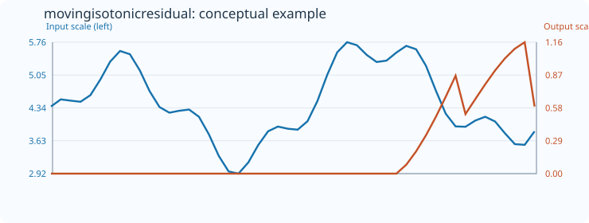
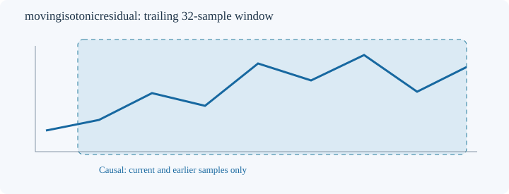

# MovingIsotonicResidual

[← Transform index](README.md) · [Rust source](../../src/transform/movingisotonicresidual.rs)

## Algorithm

Find the least-squares monotonically nondecreasing and nonincreasing fits to the trailing window using pool-adjacent-violators (PAVA). Return min(SSE_up, SSE_down)/sum((x[i]-mean)^2). This ratio measures the fraction of total variance not explained by the better monotone fit, lies in [0,1] for nonconstant windows and equals zero for a monotone window. The estimate is invariant to nonzero affine rescaling, and reversing the sign of the data swaps the two directions. Constant windows are undefined and retain default_out.

All computations use only the current trailing window. The default example uses `MovingIsotonicResidual::<f64>::new(32)`.

## Input versus output

The 50-sample conceptual illustration uses count 32; initial positions receive `default_out=0`. Blue represents the input and orange the output, each on its own vertical scale. The SVG is a schematic visualization, not a numerical regression reference.

## Window diagram

Only prior and current samples enter the calculation.

## Contracts and limitations

- Invalid window configuration or mismatched output size yields `TransformResult::Error(0)`; nonfinite input yields `Error(1)`; failed conversion yields `Error(2)`.
- Unavailable prefixes and undefined measurements preserve `default_out`.
- Finite-window descriptors are sensitive to sample rate and window length. They do not establish predictive power.

