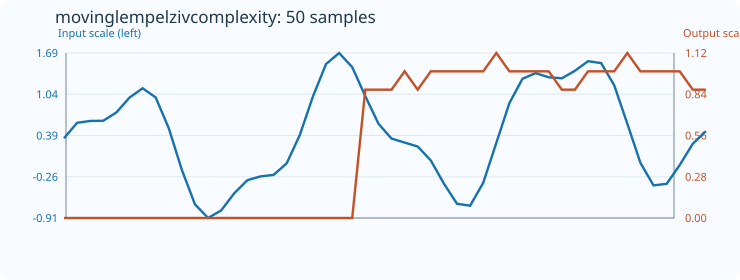
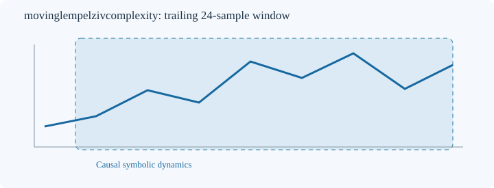

# MovingLempelZivComplexity

[← Transform index](README.md) · [Rust source](../../src/transform/movinglempelzivcomplexity.rs)

## Algorithm

Encode adjacent changes as 0 (down), 1 (equal), 2 (up). Parse the count-1 symbols with a simple exhaustive LZ76-style new-phrase parser: each phrase is the shortest substring not previously found entirely before its start; the final incomplete phrase is counted once. Return c(n)*ln(n)/(n*ln(3)), where c(n) is the phrase count and n=count-1. This is an asymptotic normalization, not an exact finite-sample bound: scores can exceed 1. Symbolization discards amplitude; strictly monotonic affine changes preserve the symbols. Complexity here is descriptive and not a formal compressor. Minimum count=8.

The estimator is causal: each output depends only on its trailing window, not future samples. The first `count-1` outputs retain `default_out`. Nonfinite input returns `TransformResult::Error(1)`; invalid counts, order, or output length return `Error(0)`; failed numeric conversion returns `Error(2)`.

## Input versus output

This 50-sample plot uses `count=24`, with `default_out=0`. The input and output curves use independent Y scales. Numeric data are embedded in the SVG for the regression check.

## Window diagram

Schematic trailing window; no future observations contribute.

## Interpretation and caveats

This is a finite-window descriptive measure, not a forecast or proof of deterministic dynamics. Results depend on symbolization, tie handling, window size and sample length. Short windows can have strong sampling bias. Values should be compared using the same parameterization and sampling rate.
