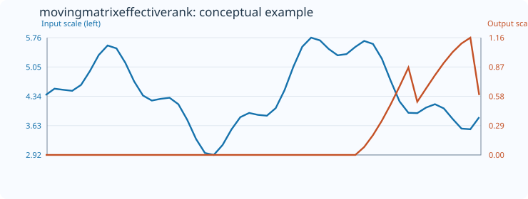
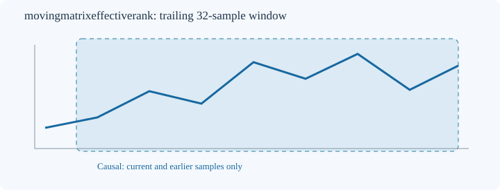

# MovingMatrixEffectiveRank

[← Transform index](README.md) · [Rust source](../../src/transform/movingmatrixeffectiverank.rs)

## Algorithm

Take a trailing count>=4 and select Hankel columns in 2..count-1. Construct the (count-columns+1) by columns Hankel matrix from overlapping samples, first subtracting the trailing-window mean from every sample. Compute a **reduced SVD** via the existing `svdwrapper` CPU/LAPACK backend. Normalize singular values greater than 1e-12 times the maximum singular value by their sum and output exp(-sum(p*ln(p))). The effective rank nominally lies between 1 and min(rows,columns), but very small numerical singular values can contribute to its floating-point estimate. Windows with maximum centered entry <= 1e-12 return default_out. The input matrix is divided by its maximum absolute entry before the SVD to reduce numerical scaling issues. SVD backend errors return Error(2). It describes the distribution of singular values, not a mathematically exact rank or number of independent sources.

All computations use only the current trailing window. The default example uses `MovingMatrixEffectiveRank::<f64>::new(32,8)`.

## Input versus output

The 50-sample conceptual illustration uses count 32 and 8 Hankel columns; initial positions receive `default_out=0`. Blue represents the input and orange the output, each on its own vertical scale. The SVG is a schematic visualization, not a numerical regression reference.

## Window diagram

Only prior and current samples enter the calculation.

## Contracts and limitations

- Invalid window configuration or mismatched output size yields `TransformResult::Error(0)`; nonfinite input yields `Error(1)`; failed conversion or SVD yields `Error(2)`.
- Unavailable prefixes and undefined measurements preserve `default_out`.
- Finite-window descriptors are sensitive to sample rate and window length. They do not establish predictive power.
- This transform requires the CPU/LAPACK-backed `svdwrapper` dependency, with associated BLAS/LAPACK runtime and link requirements. See [svdwrapper](https://github.com/witold-k/svd_wrapper).
