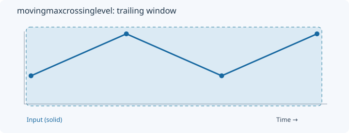
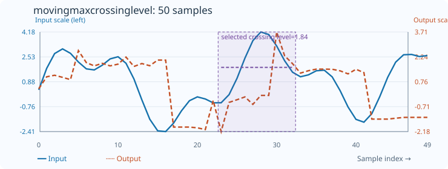

# MovingMaxCrossingLevel

[← Transform index](README.md) · [Rust source](../../src/transform/movingindicators.rs)

## Algorithm

Discretize the observed value range and return the level crossed most often.

## Window diagram

The highlighted region marks the samples considered for the final output of this algorithm.

## Input versus output

**50-sample effect plot:** count=10. The SVG contains 50 plotted values, with input/output data embedded in metadata. The Rust regression test `svg_effect_curves_match_actual_rust_transforms` decodes the orange curve and compares it with the implementation. The short numerical example below is separate.

**Numerical example:** input `[1,3,1,3]` → output `[1,2,1.6666666666666667,1.5]`. Most-crossed discretized level, count=4.

## Interpretation and caveats

The output is a level, not a crossing count. Candidate levels are low + k*(high-low)/window_length; ties keep the first candidate with the maximum crossing count. Flat windows return their constant level.

Blue solid: input; orange dashed: selected crossing level. Both are plotted on one numeric scale.
