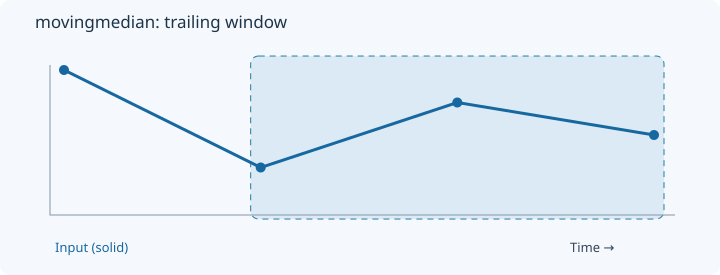
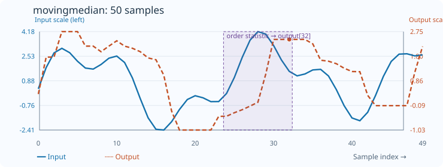

# MovingMedian

[← Transform index](README.md) · [Rust source](../../src/transform/movingmedian.rs)

## Algorithm

Sort each trailing window and select a configured rank.

## Window diagram

The highlighted region marks the samples considered for the final output of this algorithm.

## Input versus output

**50-sample effect plot:** count=9. The SVG contains 50 plotted values, with input/output data embedded in metadata. The Rust regression test `svg_effect_curves_match_actual_rust_transforms` decodes the orange curve and compares it with the implementation. The short numerical example below is separate.

**Numerical example:** input `[8,2,6,4]` → output `[8,8,6,4]`. Median rank (count=3).

## Boundary conditions and interpretation

Example count=3; full window rank=1. Prefix of length 2 selects rank=1, giving 8.

The blue line is the input and the dashed orange line is the transform output. Values are shown on a common vertical scale.
