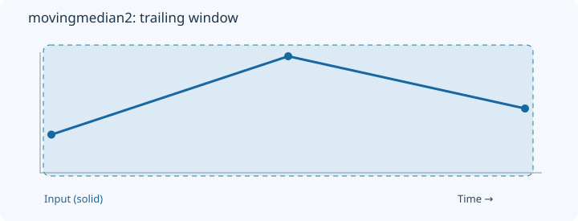
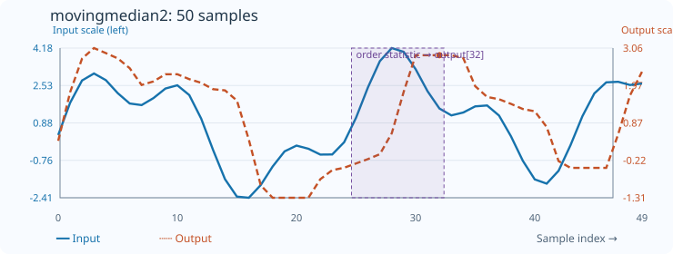

# MovingMedian2

[← Transform index](README.md) · [Rust source](../../src/transform/movingmedian2.rs)

## Algorithm

Average two selected ranks in each sorted trailing window.

## Window diagram

The highlighted region marks the samples considered for the final output of this algorithm.

## Input versus output

**50-sample effect plot:** count=8, central two ranks. The SVG contains 50 plotted values, with input/output data embedded in metadata. The Rust regression test `svg_effect_curves_match_actual_rust_transforms` decodes the orange curve and compares it with the implementation. The short numerical example below is separate.

**Numerical example:** input `[2,8,4]` → output `[2,5,5]`. Average of ranks 0 and 2, count=3.

## Interpretation and caveats

Illustration: count=3, borders=0 and 2; shorter prefixes clamp ranks.

Blue solid: input; orange dashed: output. The numerical sequence is shown above the chart.
