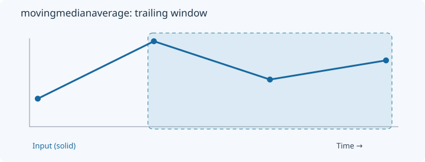
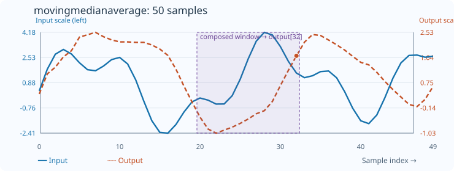

# MovingMedianAverage

[← Transform index](README.md) · [Rust source](../../src/transform/movingmedianaverage.rs)

## Algorithm

Apply a moving rank selector, then smooth its output with a moving average.

## Window diagram

The highlighted region marks the samples considered for the final output of this algorithm.

## Input versus output

**50-sample effect plot:** median_count=9, average_count=5. The SVG contains 50 plotted values, with input/output data embedded in metadata. The Rust regression test `svg_effect_curves_match_actual_rust_transforms` decodes the orange curve and compares it with the implementation. The short numerical example below is separate.

**Numerical example:** input `[2,8,4,6]` → output `[2,5,6,5]`. Median count=3, then moving average count=2.

## Interpretation and caveats

Example: median_count=3, average_count=2. Prefix medians [2,8,4,6] followed by a moving average produce [2,5,6,5].

Blue solid: input; orange dashed: output. The numerical sequence is shown above the chart.
