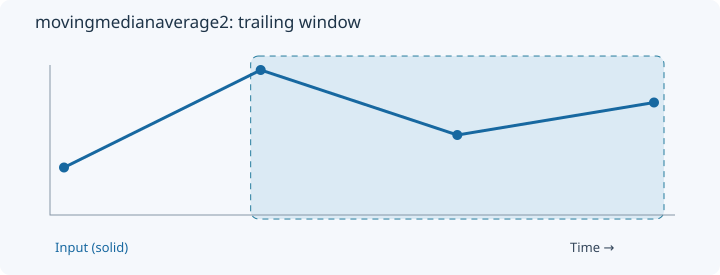
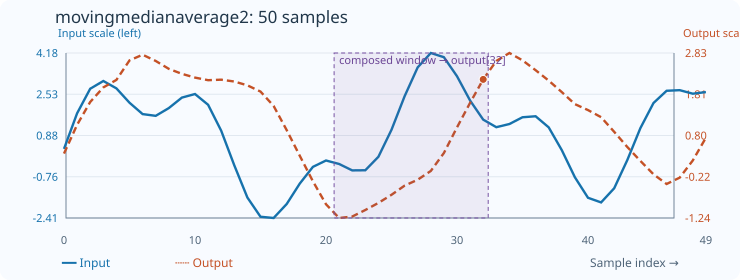

# MovingMedianAverage2

[← Transform index](README.md) · [Rust source](../../src/transform/movingmedianaverage2.rs)

## Algorithm

Average two moving order statistics, then apply a moving average.

## Window diagram

The highlighted region marks the samples considered for the final output of this algorithm.

## Input versus output

**50-sample effect plot:** median_count=8, average_count=5. The SVG contains 50 plotted values, with input/output data embedded in metadata. The Rust regression test `svg_effect_curves_match_actual_rust_transforms` decodes the orange curve and compares it with the implementation. The short numerical example below is separate.

**Numerical example:** input `[2,8,4,6]` → output `[2,3.5,5,5]`. Two-rank average count=3, then moving average count=2.

## Interpretation and caveats

Example parameters: median_count=3, average_count=2, first_border=0, second_border=2.

Blue solid: input; orange dashed: output. The numerical sequence is shown above the chart.
