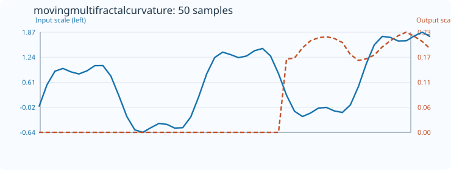
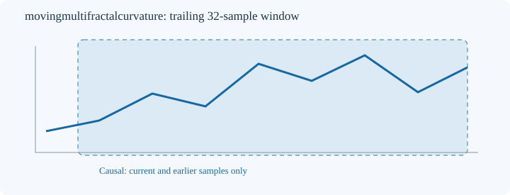

# MovingMultifractalCurvature

[← Transform index](README.md) · [Rust source](../../src/transform/movingmultifractalcurvature.rs)

## Algorithm

**Structure-function scaling curvature.** For lags s=1..min(floor(N/4),32), compute S_q(s)=mean(|x[i+s]-x[i]|^q) for q=1 and q=4. Regress log(S_q) on log(s), giving slopes zeta(1) and zeta(4). Return W=zeta(1)-zeta(4)/4. Ideal monofractal scaling zeta(q)=q*H gives zero. W is signed and is NOT the width of the multifractal singularity spectrum; its finite-sample sign and magnitude depend on lag selection and moments. Windows with insufficient positive structure functions retain default_out.

All estimates are computed on a trailing window ending at the output index, using only present and past samples. No future data or external libraries are used. The implementation lives in the shared [nonlinear-dynamics core](../../src/transform/movingfractal_core.rs).

## Input versus output

The plot contains **50 actual input samples and 50 computed output samples**, with `count=32` and `default_out=0`. The blue input curve and orange output curve use independent Y axes. Embedded SVG metadata and plotted coordinates are checked against the Rust implementation by `svg_effect_curves_match_actual_rust_transforms`.

## Window diagram

Schematic depiction of the trailing 32-sample window. Unlike the effect plot, this window diagram does not encode measurements.

## Numerical and boundary conditions

- Constructor: `MovingMultifractalCurvature::<f64>::new(count)`.
- Minimum window length: 16; the count cannot exceed the input length.
- Incomplete initial windows and undefined estimates retain `default_out`.
- Mismatched output length or invalid count returns `TransformResult::Error(0)`; nonfinite input returns `Error(1)`; nonrepresentable output returns `Error(2)`.
- The algorithms are experimental descriptive statistics. Their results are sensitive to finite-window size, noise, sampling and parameter choices. No statistical significance or forecasting guarantee is implied.
