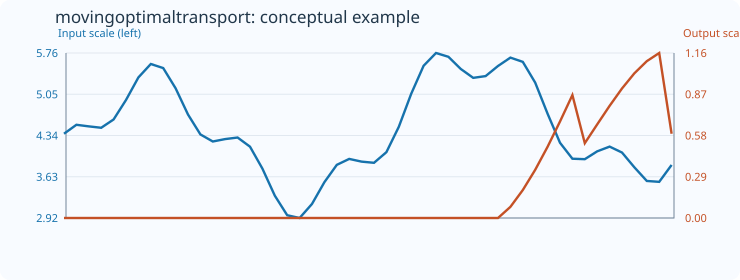
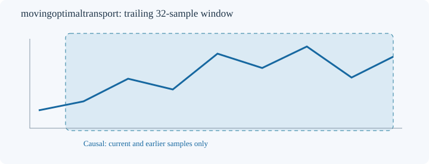

# MovingOptimalTransport

[← Transform index](README.md) · [Rust source](../../src/transform/movingoptimaltransport.rs)

## Algorithm

For an even trailing count >=4, split the window into disjoint, equally sized older and newer halves. Sort each half ascending and return the mean absolute difference of paired order statistics, the exact one-dimensional Wasserstein-1 distance between equally weighted empirical distributions. This value retains input units and is invariant under independent permutations within either half. It is nonnegative, and it detects distribution changes beyond a shift in the mean.

All computations use only the current trailing window. The default example uses `MovingOptimalTransport::<f64>::new(32)`.

## Input versus output

The 50-sample numerical illustration uses count 32; initial positions receive `default_out=0`. Blue represents the input and orange the output, each on its own vertical scale. The SVG includes its numerical data as metadata.

## Window diagram

Only prior and current samples enter the calculation.

## Contracts and limitations

- Invalid window configuration or mismatched output size yields `TransformResult::Error(0)`; nonfinite input yields `Error(1)`; failed conversion yields `Error(2)`.
- Unavailable prefixes and undefined measurements preserve `default_out`.
- Finite-window descriptors are sensitive to sample rate and window length. They do not establish predictive power.

