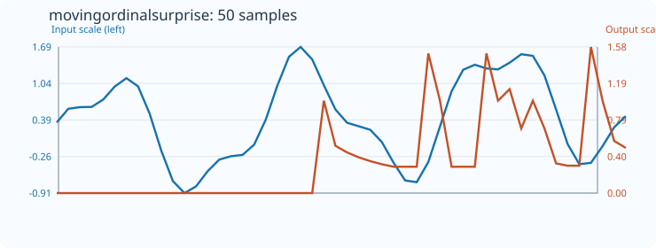
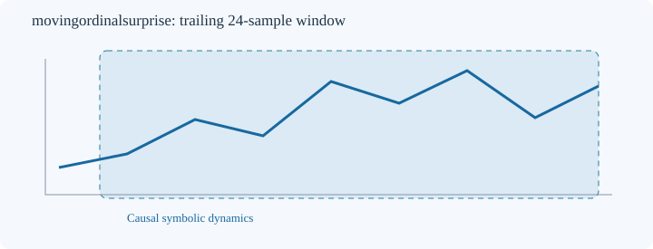

# MovingOrdinalSurprise

[← Transform index](README.md) · [Rust source](../../src/transform/movingordinalsurprise.rs)

## Algorithm

Convert each overlapping order-3 segment to a permutation ID (ties resolved by earlier index). For the final observed transition, count matching transitions in the *preceding* portion of the trailing window only. Add-one smoothing over order! successor symbols gives P=(hits+1)/(predecessor_count+order!). Return -ln(P)/ln(order!). The score may exceed 1 when a rare event is observed; it is not clipped. Parameters: count >= order+2 and 2 <= order <= 5. The held-out last transition is never used for training, avoiding lookahead and self-counting. The first windows can yield the uniform-prior surprise 1.

The estimator is causal: each output depends only on its trailing window, not future samples. The first `count-1` outputs retain `default_out`. Nonfinite input returns `TransformResult::Error(1)`; invalid counts, order, or output length return `Error(0)`; failed numeric conversion returns `Error(2)`.

## Input versus output

This 50-sample plot uses `count=24` and `order=3`, with `default_out=0`. The input and output curves use independent Y scales. Numeric data are embedded in the SVG for the regression check.

## Window diagram

Schematic trailing window; no future observations contribute.

## Interpretation and caveats

This is a finite-window descriptive measure, not a forecast or proof of deterministic dynamics. Results depend on symbolization, tie handling, window size and sample length. Short windows can have strong sampling bias. Values should be compared using the same parameterization and sampling rate.
