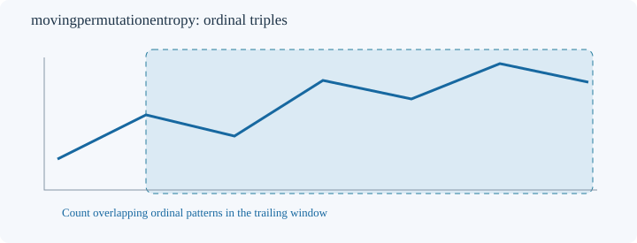
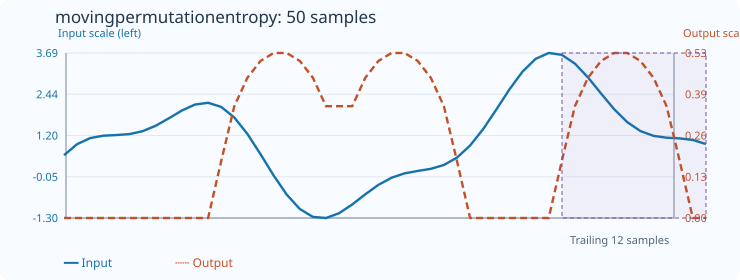

# MovingPermutationEntropy

[← Transform index](README.md) · [Rust source](../../src/transform/movingpermutationentropy.rs)

## Algorithm

Measure the diversity of ordinal patterns within a trailing window. For each consecutive block of `order` samples, sort its indices by value, breaking ties by the earlier original index (the same distinct-rank convention as `Order` and `SortedToUInt`). Count the frequencies of all `order!` possible permutations. With pattern probabilities `p[i]`, output normalized Shannon entropy `-sum(p[i] * ln(p[i])) / ln(order!)`. The value lies in `[0,1]`.

The constructor `new(count, order)` takes the number of samples in each trailing window and the ordinal pattern length. Currently `2 <= order <= 7` and `count >= order`. Each full window contains `count-order+1` overlapping patterns. Histograms are updated incrementally when the window advances.

## Window diagram

The shaded region represents the trailing samples from which overlapping ordinal patterns are counted. The drawn sequence is schematic; the patterns depend only on relative sample order.

## Input versus output

**50-sample effect plot:** count=12, order=3, default_out=0. The SVG embeds 50 input and output values. The Rust test `svg_effect_curves_match_actual_rust_transforms` checks the values and coordinates.

**Numerical example:** input `[0,1,0,1]`, count=4, order=2, default_out=0 has output `[0,0,0,0.9182958340544896]`: the three adjacent pairs yield two increasing patterns and one decreasing pattern, so the actual entropy is `-(2/3 ln(2/3) + 1/3 ln(1/3)) / ln(2) ≈ 0.9183`, not 1.

## Boundary conditions and interpretation

The first `count-1` outputs retain `default_out`; invalid parameters or nonfinite input values return errors. Equal input values receive distinct ordinal ranks in chronological order. Strictly increasing transformations of all samples preserve the result. A constant sequence has entropy zero under this tie convention. Very short windows cannot observe all `order!` patterns, so their maximum achievable entropy may be below 1. This is an in-window description of ordinal diversity, not a guarantee of unpredictability.

Blue solid: input (left axis); orange dashed: normalized entropy (right axis).
