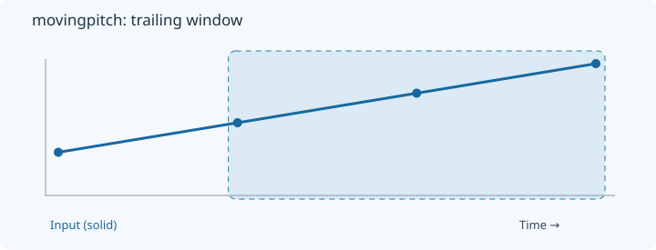
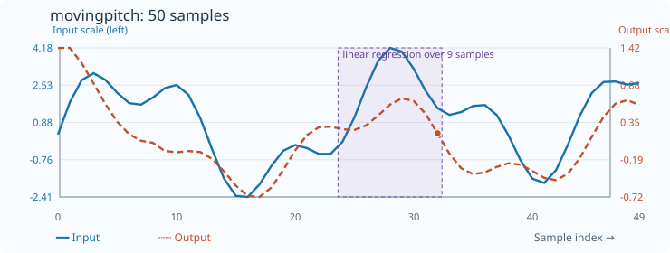

# MovingPitch

[← Transform index](README.md) · [Rust source](../../src/transform/movingpitch.rs)

## Algorithm

Estimate local linear-regression slope over a trailing window.

## Window diagram

The highlighted region marks the samples considered for the final output of this algorithm.

## Input versus output

**50-sample effect plot:** count=9, skip_first=false. The SVG contains 50 plotted values, with input/output data embedded in metadata. The Rust regression test `svg_effect_curves_match_actual_rust_transforms` decodes the orange curve and compares it with the implementation. The short numerical example below is separate.

**Numerical example:** input `[1,2,3,4]` → output `[1,1,1,1]`. Linear regression slope with count=3 and skip_first=false.

## Interpretation and caveats

The example uses skip_first=false; its first output is copied from output[1]. With skip_first=true, count−1 prefix outputs are backfilled from the first complete window (noncausal).

Blue solid: input; orange dashed: output. The numerical sequence is shown above the chart.
