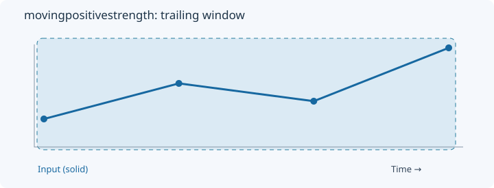
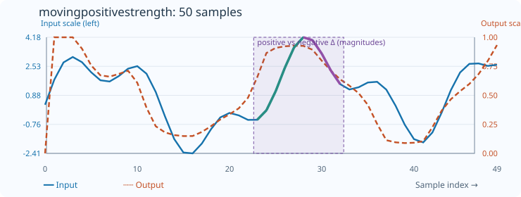

# MovingPositiveStrength

[← Transform index](README.md) · [Rust source](../../src/transform/movingindicators.rs)

## Algorithm

Divide the sum of positive step magnitudes by the sum of all absolute step magnitudes.

## Window diagram

The highlighted region marks the samples considered for the final output of this algorithm.

## Input versus output

**50-sample effect plot:** count=10. The SVG contains 50 plotted values, with input/output data embedded in metadata. The Rust regression test `svg_effect_curves_match_actual_rust_transforms` decodes the orange curve and compares it with the implementation. The short numerical example below is separate.

**Numerical example:** input `[1,3,2,5]` → output `[0,1,0.6666666666666666,0.8333333333333334]`. Positive change share, count=4.

## Interpretation and caveats

count=4; unchanged windows return zero.

Blue solid: input (squared per-sample error for MSE/RMSE); orange dashed: output. Both are plotted on one numeric scale.
