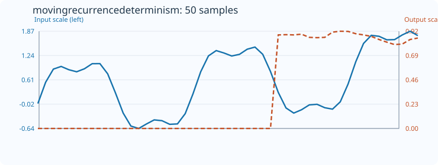
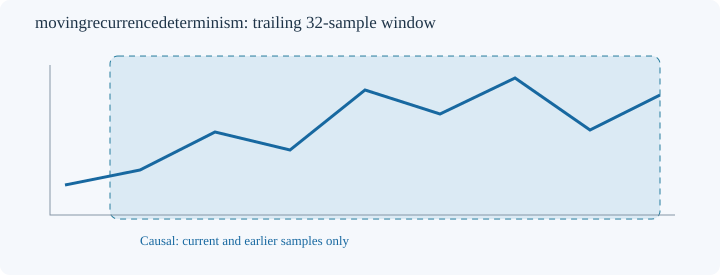

# MovingRecurrenceDeterminism

[← Transform index](README.md) · [Rust source](../../src/transform/movingrecurrencedeterminism.rs)

## Algorithm

**Recurrence plot diagonal determinism.** Build two-dimensional lag-one vectors v[i]=(x[i],x[i+1]), i=0..N-2. Mark pairs recurrent when squared Euclidean distance <= 2*(0.1*(max(x)-min(x)))^2. Exclude self-pairs and immediate neighbors (Theiler window 1). Among remaining unordered recurrent pairs i<j, count the fraction that belongs to a diagonal run of at least two recurrent points. This ratio lies in [0,1]. The radius is data-range-relative; zero-range windows and windows without eligible recurrence pairs retain default_out. High determinism does not establish a deterministic generating mechanism.

All estimates are computed on a trailing window ending at the output index, using only present and past samples. No future data or external libraries are used. The implementation lives in the shared [nonlinear-dynamics core](../../src/transform/movingfractal_core.rs).

## Input versus output

The plot contains **50 actual input samples and 50 computed output samples**, with `count=32` and `default_out=0`. The blue input curve and orange output curve use independent Y axes. Embedded SVG metadata and plotted coordinates are checked against the Rust implementation by `svg_effect_curves_match_actual_rust_transforms`.

## Window diagram

Schematic depiction of the trailing 32-sample window. Unlike the effect plot, this window diagram does not encode measurements.

## Numerical and boundary conditions

- Constructor: `MovingRecurrenceDeterminism::<f64>::new(count)`.
- Minimum window length: 8; the count cannot exceed the input length.
- Incomplete initial windows and undefined estimates retain `default_out`.
- Mismatched output length or invalid count returns `TransformResult::Error(0)`; nonfinite input returns `Error(1)`; nonrepresentable output returns `Error(2)`.
- The algorithms are experimental descriptive statistics. Their results are sensitive to finite-window size, noise, sampling and parameter choices. No statistical significance or forecasting guarantee is implied.
