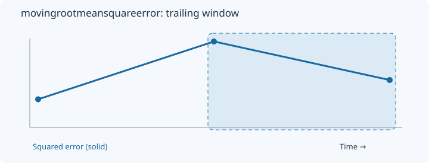
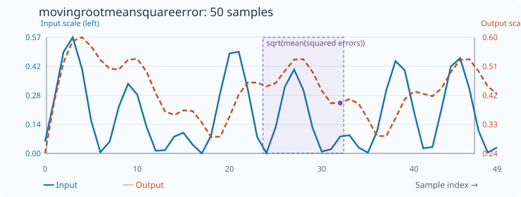

# MovingRootMeanSquareError

[← Transform index](README.md) · [Rust source](../../src/ziptransform/movingerror.rs)

## Algorithm

Take the square root of the trailing mean squared error between two sequences.

## Window diagram

The highlighted region shows the final two-error window. The blue line represents squared differences, not either original sequence.

## Input versus output

**50-sample effect plot:** count=9; blue line shows squared pointwise errors. The SVG contains 50 plotted values, with input/output data embedded in metadata. The Rust regression test `svg_effect_curves_match_actual_rust_transforms` decodes the orange curve and compares it with the implementation. The short numerical example below is separate.

**Numerical example:** pointwise squared errors `[1,4,2]` → output `[1,1.5811388300841898,1.7320508075688772]`. RMSE from pointwise squared errors [1,4,2], count=2.

## Interpretation and caveats

Blue represents pointwise squared differences of two input signals; e.g., x=[1,3,2] and y=[2,1,2+√2]. Example count=2.

Blue solid: input (squared per-sample error for MSE/RMSE); orange dashed: output. Both are plotted on one numeric scale.
