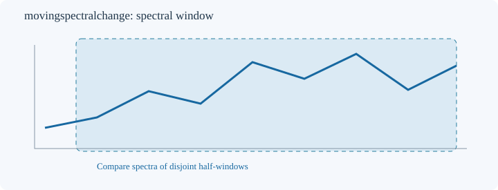
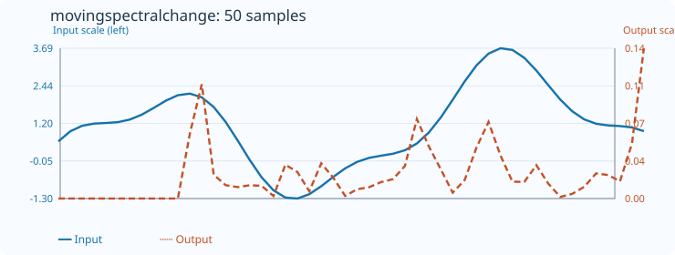

# MovingSpectralChange

[← Transform index](README.md) · [Rust source](../../src/transform/movingspectralchange.rs)

## Algorithm

The total-variation distance compares the normalized spectra of two disjoint half-windows of equal length. Each half is mean-centered and Hann-tapered independently. Requires even count >= 8. A zero value means equal distributions; one means disjoint spectral support.

For each trailing window, the shared implementation in [movingspectral_core.rs](../../src/transform/movingspectral_core.rs) computes the arithmetic mean, subtracts it, and multiplies each sample by a **symmetric Hann taper**:

```text
w[i] = 0.5 - 0.5*cos(2*pi*i/(N-1))
X[k] = sum((x[i]-mean)*w[i]*exp(-2*pi*j*k*i/N))
P[k] = c[k]*abs(X[k])^2, k = 1..floor(N/2)
p[k] = P[k]/sum(P)
```

Here `c[k]=2` for interior positive-frequency bins, and `c[N/2]=1` for the Nyquist bin when N is even. The DC bin `k=0` is excluded. These conventions matter: without doubling interior bins, Nyquist would have an artificially high relative weight. Hann tapering reduces leakage but broadens peaks, and mean subtraction does not guarantee exactly zero DC after tapering. We explicitly exclude it.

The feature is:

```text
D = (1/2) * sum(abs(p_old[k] - p_new[k]))
```

The direct DFT costs O(N²) per evaluated window, with no external FFT dependency. The transform is causal; it only uses the current and previous samples.

## Window diagram



The diagram is schematic. The full window is divided into two nonoverlapping halves before the two spectra are computed.

## Input versus output



The 50-sample plot uses `count=12` and `default_out=0`. The SVG embeds the numerical input and output arrays and both axis ranges. The test `svg_effect_curves_match_actual_rust_transforms` checks the embedded values and SVG coordinates against the Rust transform. Blue solid: input (left scale); orange dashed: output (right scale).

## Boundary conditions and interpretation

- Input/output lengths must agree. Invalid window lengths return `TransformResult::Error(0)`.
- Nonfinite input samples return `Error(1)`.
- Incomplete prefixes retain `default_out`. Constant windows or zero usable spectral energy also retain `default_out`.
- Values are dimensionless and lie in `[0,1]`; `ITEMOUT::from_f64` conversion failure returns `Error(2)`.
- Spectral estimates are affected by window length, leakage, sampling rate, and taper. Frequency is measured in **cycles per sample**, not hertz; centroid is normalized to the Nyquist frequency.
- None of these features establishes statistical significance or forecasting accuracy.
