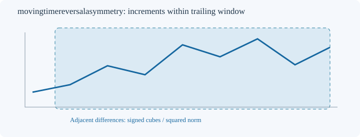
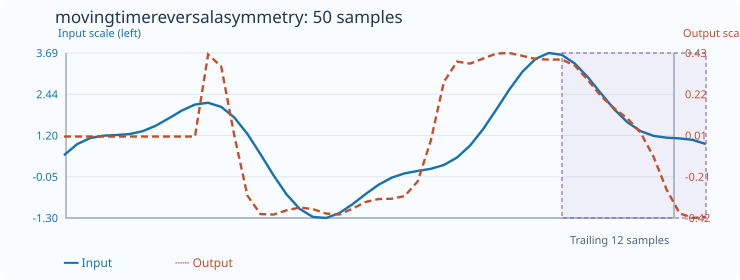

# MovingTimeReversalAsymmetry

[← Transform index](README.md) · [Rust source](../../src/transform/movingtimereversalasymmetry.rs)

## Algorithm

For a trailing window of `count` samples `x[0], ..., x[count-1]`, form its `count-1` adjacent increments `d[i] = x[i+1] - x[i]`. Return the **dimensionless normalized signed third moment**

```text
A = sum(d[i]^3) / (sum(d[i]^2))^(3/2)
```

The formula is deliberately a **ratio of sums**, without a factor of `1/(count-1)` in the numerator or denominator. It is *not* the usual sample skewness: increments are not mean-centered. In particular, a constant nonzero increment sequence produces `sign(d)/sqrt(count-1)`, not zero.

For numerical stability, the implementation computes `m = max(abs(d[i]))`, `z[i] = d[i]/m`, then evaluates `sum(z[i]^3)/(sum(z[i]^2))^(3/2)`. This cancels the common scale exactly in real arithmetic and avoids overflow when cubing large finite increments. Subtraction of adjacent input samples must still be finite; otherwise the transform returns an error.

## Mathematical properties

- **Range:** `-1 <= A <= 1`, since the absolute sum of cubes cannot exceed the three-halves power of the sum of squares.
- **Time reversal:** Reversing the order of samples negates and reverses their increments. Consequently, `A(reverse(x)) = -A(x)` for a complete window.
- **Positive affine invariance:** Replacing `x` by `a*x+b` with `a>0` preserves `A` (up to floating-point error). Negative scaling negates `A`.
- **Causality:** At output index `t`, only samples from `t-count+1` through `t` are used.
- **Interpretation:** Positive values indicate stronger positive cubic increment contributions; negative values indicate stronger negative contributions. The score combines increment direction, size and skewness, and is not a test of statistical irreversibility.

## Window diagram



The shaded region shows the samples in the trailing window. Each neighboring pair contributes one signed increment; the diagram is schematic.

## Input versus output



**50-sample effect plot:** count=12, default_out=0. The SVG embeds all 50 input and output values, together with independent axis ranges. The regression test `svg_effect_curves_match_actual_rust_transforms` checks both the embedded results and the plotted coordinates against the Rust implementation.

**Exact example:** input `[0,1,3]`, count=3 gives increments `[1,2]` and output `(1+8)/(1+4)^(3/2) = 9/(5*sqrt(5)) ≈ 0.8049844719`. Reversed input `[3,1,0]` gives the negative value. For `[5,5,5]`, the output remains `default_out`.

## Boundary conditions

The constructor is `MovingTimeReversalAsymmetry::<f64>::new(count)`; `count >= 2` and `count <= input.len()`. Output length must equal input length. The first `count-1` outputs retain `default_out`. Windows with no nonzero increments also retain `default_out`. Nonfinite input samples or nonfinite adjacent differences return `TransformResult::Error(1)`; invalid window/output lengths return `Error(0)`; a nonrepresentable output returns `Error(2)`.

Because the ratio uses a finite window, a nonzero score may result from deterministic drift, asymmetric increments, or sampling noise. It is not by itself proof of a time-irreversible generating process, nor does it imply predictive power.

Blue solid: input (left axis); orange dashed: output (right axis).
