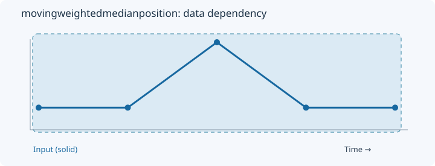
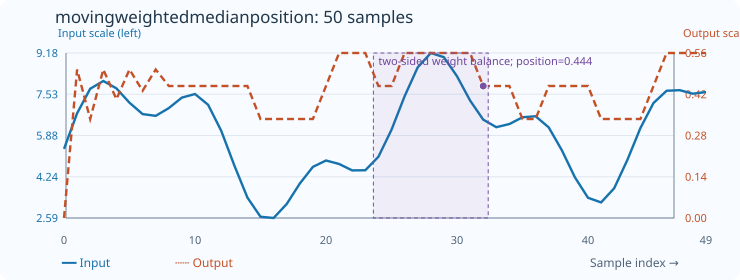

# MovingWeightedMedianPosition

[← Transform index](README.md) · [Rust source](../../src/transform/movingindicators.rs)

## Algorithm

Balance nonnegative weights from both ends of the trailing window; return the normalized meeting position.

## Window diagram

The highlight shows the samples needed for the final illustrated result. Full-sequence operations use the whole input; pointwise operations use a single value.

## Input versus output

**50-sample effect plot:** count=9; positive weights. The SVG contains 50 plotted values, with input/output data embedded in metadata. The Rust regression test `svg_effect_curves_match_actual_rust_transforms` decodes the orange curve and compares it with the implementation. The short numerical example below is separate.

**Numerical example:** input `[1,1,6,1,1]` → output `[0,0.5,0.3333333333333333,0.5,0.4]`. Balancing nonnegative weights, count=5.

## Interpretation and caveats

count=5; negative or nonfinite weights are rejected. The plotted output uses available prefixes.

Blue solid: input; orange dashed: normalized meeting position. Both are plotted on one numeric scale.
