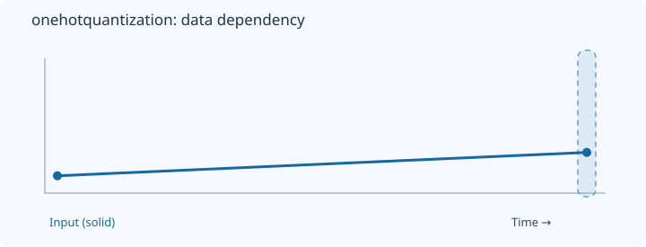
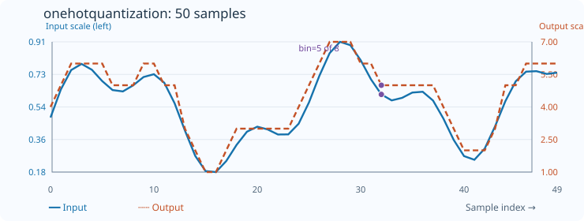

# OneHotQuantization

[← Transform index](README.md) · [Rust source](../../src/transform/onehotquantization.rs)

## Algorithm

Scale and round each input to a one-hot output bin.

## Window diagram

The highlight shows the samples needed for the final illustrated result. Full-sequence operations use the whole input; pointwise operations use a single value.

## Input versus output

**50-sample effect plot:** factor=8; orange line shows bin index, not expanded one-hot vector. The SVG contains 50 plotted values, with input/output data embedded in metadata. The Rust regression test `svg_effect_curves_match_actual_rust_transforms` decodes the orange curve and compares it with the implementation. The short numerical example below is separate.

**Numerical example:** input `[0.1,0.7]` → selected bin indices `[0,3]`. Selected bin indexes, factor=4. Expanded one-hot output is [1,0,0,0,0,0,0,1].

## Interpretation and caveats

Factor=4. The orange curve represents the selected bin index, while the actual output contains two blocks of four values: [1,0,0,0,0,0,0,1].

Blue solid: input; orange dashed: output. The numerical sequence is shown above the chart.
