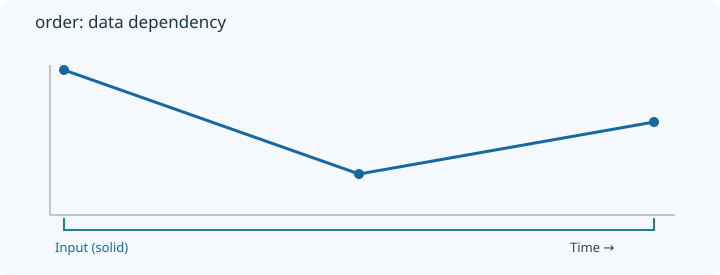
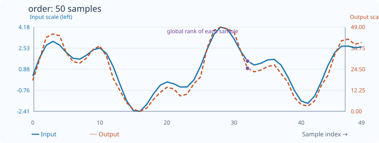

# Order

[← Transform index](README.md) · [Rust source](../../src/transform/order.rs)

## Algorithm

Assign an ascending rank to each original input position.

## Window diagram

The highlight shows the samples needed for the final illustrated result. Full-sequence operations use the whole input; pointwise operations use a single value.

## Input versus output

**50-sample effect plot:** factor=0; global rank. The SVG contains 50 plotted values, with input/output data embedded in metadata. The Rust regression test `svg_effect_curves_match_actual_rust_transforms` decodes the orange curve and compares it with the implementation. The short numerical example below is separate.

**Numerical example:** input `[5,1,3]` → output `[2,0,1]`. Ascending ranks mapped to input positions.

## Interpretation and caveats

Equal values receive distinct ranks; unordered values are rejected.

Blue solid: input; orange dashed: output. The numerical sequence is shown above the chart.
