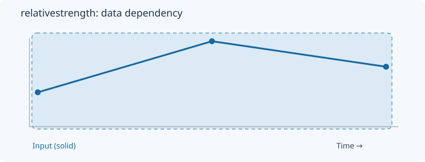
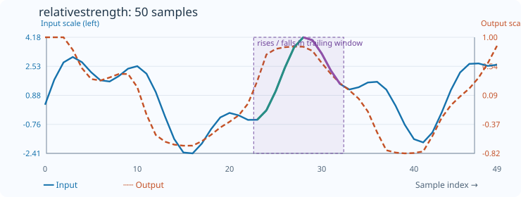

# RelativeStrength

[← Transform index](README.md) · [Rust source](../../src/transform/relativestrength.rs)

## Algorithm

Compare summed upward and downward changes using (up−down)/(up+down).

## Window diagram

The highlight shows the samples needed for the final illustrated result. Full-sequence operations use the whole input; pointwise operations use a single value.

## Input versus output

**50-sample effect plot:** count=10, skip_first=false. The SVG contains 50 plotted values, with input/output data embedded in metadata. The Rust regression test `svg_effect_curves_match_actual_rust_transforms` decodes the orange curve and compares it with the implementation. The short numerical example below is separate.

**Numerical example:** input `[1,3,2]` → output `[1,1,0.3333333333333333]`. Signed rise/fall strength, count=3, skip_first=false; the first output uses the first two samples.

## Interpretation and caveats

For count=3 and skip_first=false, the first output is based on the first two samples, so it is 1 rather than 0.

Blue solid: input; orange dashed: output. The numerical sequence is shown above the chart.
