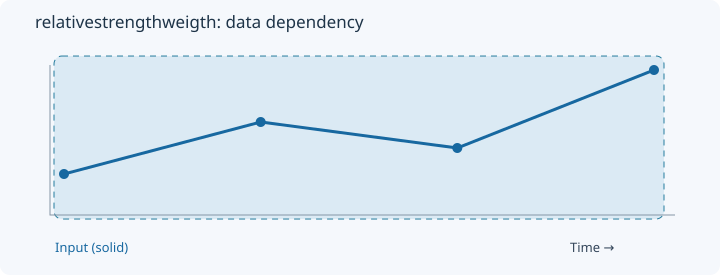
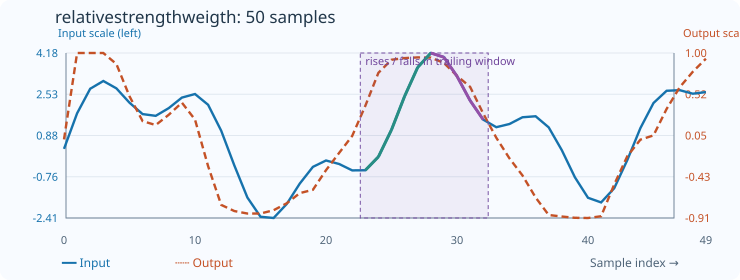

# RelativeStrengthWeigth

[← Transform index](README.md) · [Rust source](../../src/transform/relativestrengthweigth.rs)

## Algorithm

Weight the rise and fall contributions before computing signed relative strength.

## Window diagram

The highlight shows the samples needed for the final illustrated result. Full-sequence operations use the whole input; pointwise operations use a single value.

## Input versus output

**50-sample effect plot:** count=10, skip_first=false. The SVG contains 50 plotted values, with input/output data embedded in metadata. The Rust regression test `svg_effect_curves_match_actual_rust_transforms` decodes the orange curve and compares it with the implementation. The short numerical example below is separate.

**Numerical example:** input `[1,3,2,5]` → output `[0,1,0.3333333333333333,0.7142857142857143]`. Weighted signed strength with ordinal occurrence weights, count=4, skip_first=false.

## Interpretation and caveats

Rising and falling steps are weighted separately by their ordinal occurrence (1, 2, ...), resetting in every window.

Blue solid: input; orange dashed: output (selected bin index for OneHotQuantization). Both are plotted on one numeric scale.
