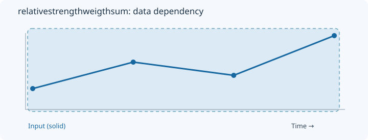
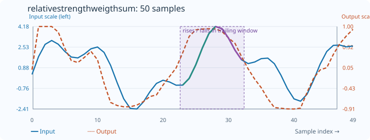

# RelativeStrengthWeigthSum

[← Transform index](README.md) · [Rust source](../../src/transform/relativestrengthweigthsum.rs)

## Algorithm

Compute weighted rise/fall strength using the same underlying accumulators as RelativeStrengthWeigth. Despite its name, this implementation does not cumulatively sum the strength outputs.

## Window diagram

The highlight shows the samples needed for the final illustrated result. Full-sequence operations use the whole input; pointwise operations use a single value.

## Input versus output

**50-sample effect plot:** count=10, skip_first=false. The SVG contains 50 plotted values, with input/output data embedded in metadata. The Rust regression test `svg_effect_curves_match_actual_rust_transforms` decodes the orange curve and compares it with the implementation. The short numerical example below is separate.

**Numerical example:** input `[1,3,2,5]`, count=4, skip_first=false. The implementation's actual prefix outputs differ from RelativeStrengthWeigth: `[0,0,1,0.7142857142857143]`. The discrepancy is caused by the prefix indexing. This transform is not cumulative.

## Interpretation and caveats

The prefix indexing differs from RelativeStrengthWeigth for count greater than two; this is a known implementation discrepancy. The effect chart should be read with this corrected prefix sequence.

Blue solid: input; orange dashed: output (selected bin index for OneHotQuantization). Both are plotted on one numeric scale.
