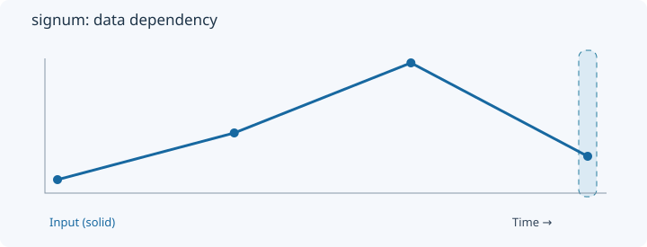
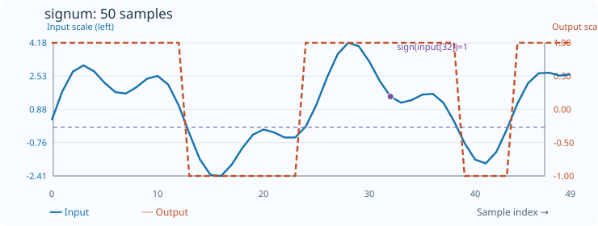

# Signum

[← Transform index](README.md) · [Rust source](../../src/transform/signum.rs)

## Algorithm

Replace each input by its sign.

## Window diagram

The highlight shows the samples needed for the final illustrated result. Full-sequence operations use the whole input; pointwise operations use a single value.

## Input versus output

**50-sample effect plot:** sign of each input. The SVG contains 50 plotted values, with input/output data embedded in metadata. The Rust regression test `svg_effect_curves_match_actual_rust_transforms` decodes the orange curve and compares it with the implementation. The short numerical example below is separate.

**Numerical example:** input `[-2,0,3,-1]` → output `[-1,0,1,-1]`. Map each value to its sign.

## Boundary conditions and interpretation

The operation concerns values, not differences.

The blue line is the input and the dashed orange line is the transform output. Values are shown on a common vertical scale.
