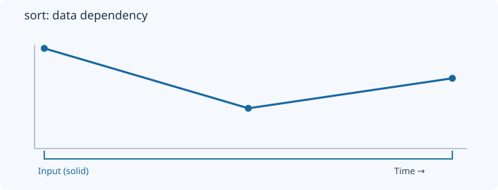
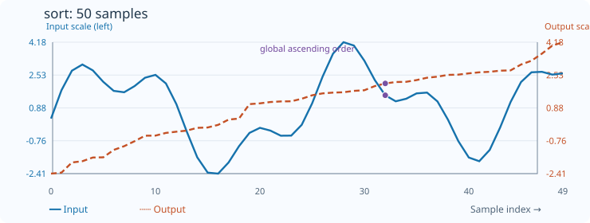

# Sort

[← Transform index](README.md) · [Rust source](../../src/transform/sort.rs)

## Algorithm

Sort the complete input sequence in ascending order.

## Window diagram

The highlight shows the samples needed for the final illustrated result. Full-sequence operations use the whole input; pointwise operations use a single value.

## Input versus output

**50-sample effect plot:** full-sequence ascending sort. The SVG contains 50 plotted values, with input/output data embedded in metadata. The Rust regression test `svg_effect_curves_match_actual_rust_transforms` decodes the orange curve and compares it with the implementation. The short numerical example below is separate.

**Numerical example:** input `[3,1,2]` → output `[1,2,3]`. Ascending sort of complete sequence (not time-aligned).

## Interpretation and caveats

Not a causal time-series transform: sorting discards chronological ordering.

Blue solid: input; orange dashed: output (selected bin index for OneHotQuantization). Both are plotted on one numeric scale.
